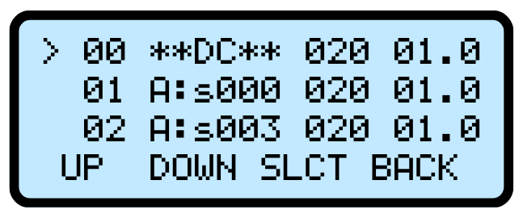
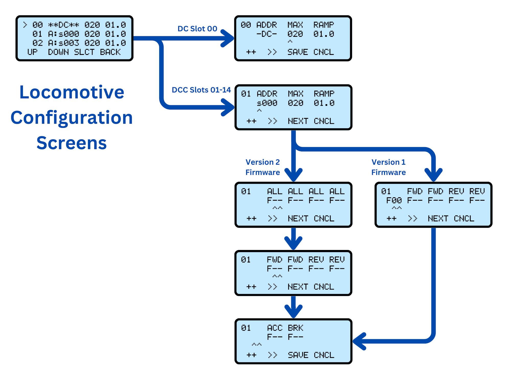
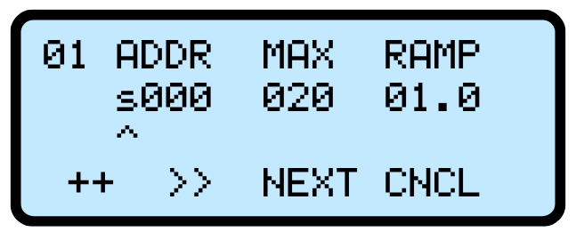
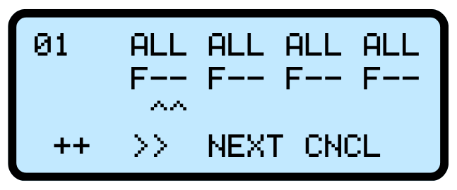
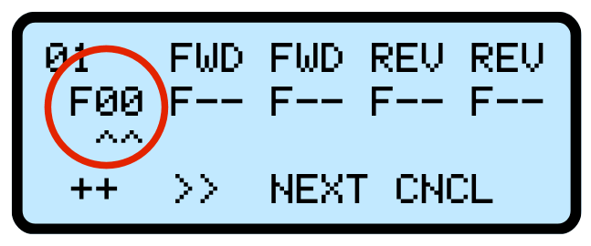
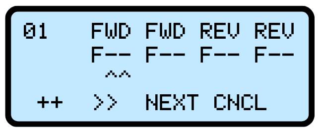
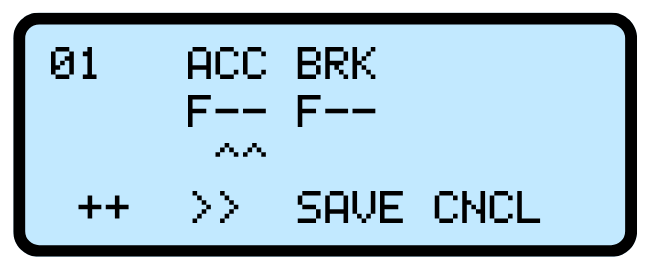
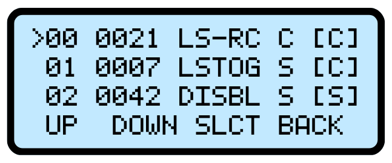
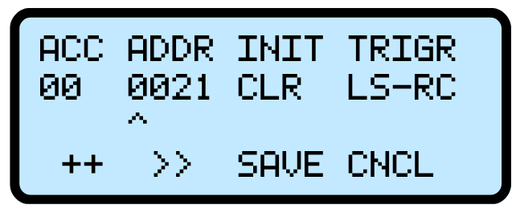

# Motorman {align=right style="height: 75px; margin-top:0px; margin-bottom: 0px"} User Manual

## Overview

The Iowa Scaled Engineering [Motorman](https://www.iascaled.com/store/CKT-PINGPONG) is an automatic train shuttle controller for both DC and DCC locomotives. Using TrainSpotter infrared sensors at each end, the Motorman will continuously drive the train back and forth, automatically stopping and reversing at the end of track as well as intermediate station stops. With control of the speed, locomotive address, delay time, and DCC accessory decoders, many different scenarios for automatic operation are supported.

### Features

* Stores settings for up to 15 DCC locomotives
* Operates one DC or DCC locomotive or consist at a time on a single track
* Adjustable acceleration and deceleration rates
* Operates any long or short DCC address, including consists
* Supports intermediate stops (with additional sensors)
* Operates up to 6 accessory decoders based on selectable trigger events
* Fully integrated unit with simple, intuitive interface
* Built-in track short circuit protection
* 2 amp integrated output booster
* Optional track power switch for use with existing DC / DCC system

### Typical Applications

* Train show demo layouts
* Museum displays
* Home layout automation

### Kit Contents

* Control unit with LCD and buttons
* 12 volt, 3 amp wall power supply
* 2x TrainSpotter infrared detectors

---

## Quick Start Guide

!!! warning "Please Note"
    All wiring and setup should be done with the power off.  This significantly reduces the chances of accidentally slipping and causing a short circuit that damages the board or the detectors.

### 1 - Connect to the Track

!!! warning "Isolate the Track"
    The Motorman must be the only thing powering the track when it's operating, and must be disconnected if any other device is powering the track.  This can be accomplished via a double pole-double throw switch that can swap track power between the Motorman and your existing throttle / DCC booster.

Connect the track power bus to terminal block J2. 

For DCC use, the polarity does not matter. If using DC mode, then the physical direction corresponding to forward and reverse will depend on the polarity of the feeder wires connected to the terminal block. If you end up with the direction opposite what you desire, then simply swap the two track wires in the terminal block.

### 2 - Position and Connect Sensors

The basic kit includes two TrainSpotter optical sensors - one for each end of a point-to-point run.  

Looking at your track, designate one direction left and one direction right.  Locate where you think each sensor should go, making sure you mount it far enough from the end of track to give equipment space to decelerate and stop.  You can configure this to be as quickly as a tenth of a second from when the sensor is tripped, but it will be jarring and won't appear very prototypical.  If it's happening in a hidden space, however, this may be fine.

We recommend temporarily positioning them on the layout using small boxes or other supports to figure out the exact placement before drilling any holes and committing to a location.  Just make sure they don't come in contact with rails or anything else energized, or damage will result.

Once you've figured out where you want them, connect them to the Motorman control board.  Both red wires to into the **+12V** terminal.  Both black wires go into the **GND** terminal.   The white wire from the left sensor goes into the **LEFT** terminal, and correspondingly, the white wire from the right sensor goes into the **RIGHT** terminal.

If you need longer wires to reach the ends of your track, just extend the wires using any small wire you have handy.  There's no significant length limit on how far the sensors can be from the control unit.

### 3 - Power the Motorman

Plug the barrel jack from the included power supply into the Motorman control unit, then plug the power supply into the wall.  The Motorman should power up, lighting the screen and diagnostic LEDs on the back of the board.

### 4A - Basic Configuration for DC

If you are running with DCC, skip on to step 4B.

The Motorman comes by default in DCC mode, since that's the most common.  If you need to change to DC mode, you'll need to change it.  Go into the Configuration menu and change [DC or DCC mode](#dcdcc-output) to output DC instead.

### 4B - Basic Configuration for DCC

---

## Operations

### Learning Mode

!!! info "Equipment Direction vs. Track Direction"
    An important concept to understand is the difference between track direction and equipment direction. Think of the problem this way – forward is relative to the locomotive, not to which direction it is headed on the track. The locomotive can go forward to the left, or it can go forward to the right, depending on which way it’s pointed. For the sensors installed along the track, their direction is always the same, because their relation to the track doesn’t change. One will be to the left, one will be to the right. 
    
    In this manual, the two ends of the track will be denoted as “left” and “right”, whereas the two directions of equipment travel will be denoted as “forward” and “reverse”.

When the Motorman starts up or goes through reinitialization, normally it will start in "Learning Mode."   It expects the locomotive to be located along the center section of the track, somewhere between the two end sensors.  It will then command the locomotive to drive forward until one or the other end sensor is triggered.  This is how it learns whether left or right is forward.

You can tell the Motorman is in learning mode by schecking the Operational State on the main screen, or the Sensor Input monitor.

Once the Motorman has learned which sensor (left or right) corresponds with forward movement, it will then start normal operation.

For operations where the relationship between forward and reverse will never change, you can use the Sensor Learning configuration setting to define which way is forward and reverse.  Normally it is better to just let it learn, but with certain applications it's better to configure it from the start.  

If you need the Motorman to relearn its directions, there are two ways to do this.  The first is to use the Stop Relearns Direction configuration option.  This will put the Motorman back in learning mode whenever the stop key is pressed on the main screen.  It will not, however, set all of the accessory decoders back to their original states.  It will just relearn the end sensors.

The section option is to use the Manual Operation screen.  When you exit it using the RINIT key, the system goes through a full reinitialization and starts up as if power had just been applied.  This will reset all accessory decoders to their original states and relearn direction.

### Normal Operation

## The Main Screen

### Operational State

The heart of the Motorman is a concept called a "state machine" - essentially a list of rules expressed as "Do this until X happens, then go on the next rule."  For example, a traffic light will display green until a timer expires.  We'll call that the green state.  When the timer in the green state expires, the next rule is start a new timer and display yellow.  The yellow state has an exit condition of the yellow timer expiring.  When that timer expires, it displays red and starts another timer.  When that timer expires, it goes back to the green state.

The Motorman is very similar.  It will drive forward until it reaches the end sensor in the forward direction.  Once it gets there, it decelerates until it stops.  Then it waits, reverses, and accelerates in the opposite direction.  These are all defined as "states" and you can see what it's currently doing and expecting based on the state displayed on the main screen.

* **LRN – Learning**  The Motorman is learning which track direction corresponds with forward. Once an end sensor is reached, that track direction (left or right) will be deemed “forward” until such time that the locomotive is changed, the STOP key is pressed (configurable), a reinitialization is triggered from [Manual Operation](#manual-operation), or the power is cycled. This association between left/right and forward/reverse will be indicated in the “Sensor Inputs” section of the main screen.

* **FWD – Forward Travel** The locomotive is driven forward at the speed set in the locomotive profile until either the end stop sensor is reached, or an intermediate sensor opposite the forward end is reached. If the end sensor is tripped, the state will go to FDC. If an intermediate sensor is tripped, the state will go to FID.

* **REV – Reverse Travel** The locomotive is driven in reverse at the speed set in the locomotive profile until either the end stop sensor is reached, or an intermediate sensor opposite the reverse end is reached. If the end stop sensor is tripped, the state will go to RDC. If the intermediate sensor is tripped, the state will go to RID.

* **FDC – Forward Deceleration** The forward direction end stop sensor has been tripped and the speed is decreasing to zero based on the locomotive’s ramp rate. Once the current speed reaches zero, the state will transition to FTR. 

* **FTR – Forward to Reverse Delay** The locomotive has stopped its forward travel and is waiting the configured Endpoint Delay to reverse direction. Once the delay has expired, the state will transition to REV 

* **FTF – Forward to Forward Delay**  The locomotive has stopped its forward travel and is waiting the configured Endpoint Delay. Once the delay has expired, the state will transition to FWD and the locomotive will continue forward.  *Only applicable in Loop or Loop to Loop [travel modes](#travel-mode).*

* **RDC – Reverse Deceleration** The reverse direction end stop sensor has been tripped and the speed is decreasing to zero, as set by the locomotive’s ramp rate. Once the current speed reaches zero, the state will transition to RTF.

* **RTF – Reverse to Forward Delay** The locomotive has stopped its reverse travel and is waiting the configured Endpoint Delay to reverse direction. Once the delay has expired, the state will transition to FWD

* **FID – Forward Intermediate Deceleration** A forward intermediate sensor has been tripped and the equipment is decelerating to zero speed. Once the speed reaches zero, the state will transition to FIW.

* **RID – Reverse Intermediate Deceleration** A reverse intermediate sensor has been tripped and the equipment is decelerating to zero speed. Once the speed reaches zero, the state will transition to RIW.

* **FIW – Forward Intermediate Wait** The locomotive has stopped in the forward direction at an intermediate sensor, and will wait for the configured delay. Once the delay expires, state will transition to FIA.

* **RIW - Reverse Intermediate Wait** The locomotive has stopped in the reverse direction at an intermediate sensor, and will wait for the configured delay. Once the delay expires, the state will transition to RIA.

* **FIA – Forward Intermediate Acceleration** The locomotive is accelerating forward out of an intermediate stop. As soon as the tripped intermediate sensor clears, the state will transition to FWD.

* **RIA – Reverse Intermediate Acceleration** The locomotive is accelerating in reverse out of an intermediate stop. As soon as the tripped intermediate sensor clears, the state will transition to REV.

## Manual Operation

From the main screen, the MANL key will allow you to operate the current locomotive manually.  

!!! note "Change From v1 Firmware"
    In version 1, the manual operation was still affected by sensor triggers and acceleration/deceleration rates, and was confusing to users.  In version 2 firmware, manual operation is immediate and overrides automatic operation completely.

**SPD+** and **SPD-** will increase and decrease the current locomotive speed by 1%.  **F<>R** will immediately set the speed to 0 and reverse the direction.  RINIT will exit manual operation and reinitialize the operating state.

## Firmware Changes

**Version 1.0** 
*Released ???*

**Version 2.0** *Released 10/15/2026*

Adds the following features:
* Added three extra "always on" DCC functions for each locomotive configuration
* Added Travel Mode menu to allow for Loop and Loop to Loop track configurations
* Added Sensor Learning menu to pre-configure the relationship between forward and reverse and left and right.  
* Added Resume on Power On option, which allows the Motorman to pick up exactly where it left off when the power is cycled, such as in a museum display that gets turned on and off every day.  
* Changes how Manual Operation works.  Previously, Manual Operation would try to tweak and adjust the automatic Motorman operation.  This often led to confusion for users.  It is now fully manual, and allows you to manually operate equipment without the Motorman's automatic functions getting in the way.  
* End and midpoint delays can now be up to 65535 seconds, rather than the previous 255 seconds.

Fixes the following bugs:

* "Stop Relearns Direction" didn't actually save and was only effective until the power turned off.
* Reloads locomotive configuration when changing the DC loco configuration in DC mode.  Previously it only took effect on the next power cycle.
* Several configuration menu save keys had some anomalous code that could have prevented saving in rare cases.

---

## Locomotive Configuration

These are configured from the the **Accessory Config** menu.

The **Locomotive Configuration** screen allows you to configure and store up to 15 locomotive configurations – one for DC operation and 14 for DCC operation.

Slot 00 is always DC, and is the only configuration for DC.  Slots 01 to 14 are for DCC operation.  

Slot 00 is automatically used when [DC operation](#dcdcc-output) is selected.  For DCC operation, the **LOAD** button on the main screen is used to select which configuration slot is active.

Each line shows the configuration slot number, DCC address (or ****DC**** for slot 0), maximum speed (0 to 100%) and ramp rate (0.1 to 25.5 seconds). Use the **UP/DOWN** keys to select the configuration to change, and press the **SLCT** key to reconfigure that go into the Configure Locomotive screen #1. The **BACK** key will take you back to the main configuration screen.

Here's a flowchart of how the screens fit together:

---

### Address & Speed

The first screen sets the locomotive address, maximum speed, and acceleration/deceleration rate.  It shows the configuration slot number in the upper left corner as a reminder of which slot you're changing.

The keys operate similarly for all of the configuration screens.  The third line will have a **^** (carat) showing which digit or field is currently being changed.  Use the **++** key to increment the current field, and the **>>** key to change which digit or field is being adjusted (as shown by the ^ under the value).  

**ADDR** is the address of the locomotive or consist being controlled by this slot.  If you're configuring the DC slot (00), this will just show **-DC-** since there's no address to specify. 

To specify a short DCC address, set the first slot to **s** followed by a number between 0-127.  For long DCC addresses, change the first digit to an appropriate number, including 0 for addresses less than four digits.

**MAX** is the maximum speed, expressed as a percentage from 1-100%.  

!!! info "DC Maximum Speed" 
    Note that for DC, the **MAX** percentage directly corresponds to track voltage.  Depending on the motor and any electronics in the locomotive, you may have to go up to 30-50% just to get the thing to move due to static friction, voltage drops, etc.

**RAMP** is the number of seconds that the Motorman will take to accelerate the locomotive from a stop, or decelerate into a stop after the sensor is tripped.

!!! info "DCC Decoder Momentum" 
    The Motorman assumes that it is in direct control of the equipment, and **RAMP** will be how fast it accelerates or decelerates a locomotive.  Any momentum set up in the decoder will be on top of this.  In general, it's preferable to either use decoder momentum or Motorman momentum rather than trying to mix them.

If you're configuring one of the 14 DCC slots (01-14), the **NEXT** key will move you on to the first function configuration screen.  If you're configuring the DC slot (00), then you'll have a **SAVE** button instead that will save the configuration.  To cancel out without saving any changes, press the **CNCL** key.

---

### Function Screens

These two (version 1 firmware) or three (version 2 firmware) screens allows you to set DCC decoder function behavior. 

For all of them, **F--** indicates that no function is selected. If the field is set to **F00** to **F28**, that function will be active when this locomotive slot is active.

The keys operate similarly for all of the configuration screens.  The third line will have a **^** (carat) showing which field is currently being changed.  Use the **++** key to increment the current field, and the **>>** key to change which field is being adjusted.  

!!! info "F29 to F68 Not Supported"
    The Europeans have added more functions to the DCC specification through RCN-212.  The Motorman only currently supports F00-F28.

---

#### Always On Functions

These functions will always be active for this locomotive, no matter the direction of travel.  This is useful for things like the "engine run" on most sound decoders that need to be active for sounds to work or the locomotive to move, or for functions that turn on lights that are always desired to be on, such as rotary beacons or even F0 for directional headlights.

For version 2, the whole first screen is dedicated to four "always on" functions.  Each of these functions is labeled "ALL" and it looks like this:

#### Always On Functions (v1)

!!! info "Version 1 Firmware Only" 
    The original Motorman firmware only supported a single "always on" function.  

Version 1 of the Motorman firmware only supported a single "always on" function.  It's on the first function screen - same as the directional functions - and located on the far left near the slot number.  It's circled in red below.

---

#### Direction Functions

The Motorman has provisions to turn on up to two functions when the locomotive is running forward (labeled **FWD**), and two functions when the locomotive is running in reverse (labeled **REV**).  These are useful for things like ditch lights, Mars or Gyralights, or non-directional headlight functions.  

For version 1 firmware, these share the same screen as the single "always on" function.

---

#### Accel/Brake Functions

The Motorman also has a single function that can be turned on during acceleration, and one that can be turned on during braking / stopping.  The **ACC** function will be enabled when a locomotive is accelerating out of a stop, and turned off once the locomotive reaches full speed.  The **BRK** function will be turned on when a locomotive trips a sensor and starts decelerating, and remain on until the locomotive is ready to accelerate again.

---

## Accessory Configuration

While operating in DCC mode, the Motorman to drive up to six accessory decoders based on sensor triggers.  These are configured from the the **Accessory Config** menu.

The main screen shows each of six slots and a summary of what's in each one.  First is the two digit slot number, then the four digit accessory extended address (0001-2044), then the trigger type, the current state (**S**=set, **C**=cleared), and the initialization state in braces (**[S]**=set, **[C]**=cleared).

Using the **UP** and **DOWN** keys, you can select which slot you want to change using the **>** on the left and then pressing **SLCT**.  At that point, you will go into the accessory configuration screen

!!! warning "Accessory Power Draw"
    Remember that any power used by accessory decoders and their loads comes out of the Motorman's 2 amp output power limit.  Thus, it's recommended to avoid things like twin coil switch machines that draw significant power, as the instantaneous rush of current may trigger the Motorman's overcurrent protection.  Tortoises or similar low-power stall motor machines attached to accessory decoders such as the NCE SwitchIt are recommended.

### Configure Accessory Slot

Each accessory slot will give a screen allowing you to configure the details of that slot.  On the left, under **ACC** will be the slot number as a reminder.  Then the four-digit extended accessory address under **ADDR**, which runs from 0001-2044.  **INIT** will be the state sent to the decoder when the Motorman initially powers up or goes through a reinitialization.  Finally, **TRIGR** defines what causes the accessory state to change between clear and set.

#### Trigger Types
* **DISBL - Disable** - Do not use this accessory configuration at all. No initialization will be sent, and it will never change in response to sensor input.  Unused accessory decoders should be left as DISBL.
* **INIT – Initialize Only** – Set the accessory decoder to its configured initial state only when the unit powers up. Never changes based on sensors.
* **LSTOG - Left Stop Toggle** - When the left end stop is reached, toggle the state of this accessory address (set will go to clear, clear will go to set). The right end stop has no effect.
* **RSTOG – Right Stop Toggle** – When the right end stop is reached, toggle the state of this accessory address (set will go to clear, clear will go to set). The left end stop has no effect.
* **XSTOG – Both Stop Toggle** – When either end stop is reached, toggle the state of this accessory address (set will go to clear, clear will go to set).
* **LC_RS – Left Clear, Right Set** – Clear the accessory when the left end stop sensor is triggered, set the accessory when the right end stop sensor is triggered.
* **LS_RC – Left Set, Right Clear** – Set the accessory when the left end stop sensor is triggered, clear the accessory when the right end stop sensor is triggered.
* **LE_ST – Left End Station Trigger** – Set the accessory when a locomotive reaches the left end stop sensor and clear it when it departs,
* **RE_ST – Right End Station Trigger** – Set the accessory when a locomotive reaches the right end stop sensor and clear it when it departs,
* **XE_ST – Both End Station Trigger** – Set the accessory when a locomotive reaches either end stop sensor and clear it when it departs,
* **LI_ST – Left Intermediate Station Trigger** – Set the accessory when a right-bound locomotive reaches the left intermediate sensor and clear it when it departs.
* **LI_ST – Left Intermediate Station Trigger** – Set the accessory when a left-bound locomotive reaches the right intermediate sensor and clear it when it departs.
* **XI_ST – Left Intermediate Station Trigger** – Set the accessory when a locomotive reaches the intermediate sensor approaching an intermediate stop in either direction, and clear it when it departs.

---

## Other Configuration Options

### DC/DCC Output

The Motorman has the ability to act as a small DCC command station or a regular DC throttle.  This menu controls what sort of signal is sent out to the track.  The **DCC** key selects DCC mode while the **DC** key selects DC mode. The **SAVE** key will save and activate the selected setting. To cancel out without saving any changes, press the **CNCL** key.

### Endpoint Delay

The endpoint delay is how long the locomotive will wait at each end of the run.  This is the time between when the locomotive reaches a stop and when it begins to accelerate again.  This is used for the FTR, RTF, and FTF [operational states](#operational-state).

The value is configurable between 0 and 65535 seconds (a bit over 18 hours), and defaults to 2 seconds.  Use the **++** key to increment the current digit, and the **>>** key to change which digit is being adjusted (as shown by the ^ under the value).  The **SAVE** key will save and activate the selected setting. To cancel out without saving any changes, press the **CNCL** key.

### Midpoint Delay

The midpoint delay is how long the locomotive will wait at any intermediate station stop.  This is the time between when the locomotive reaches a stop and when it begins to accelerate again.  This is used for the FIW and RIW [operational states](#operational-state).

The value is configurable between 0 and 65535 seconds (a bit over 18 hours), and defaults to 2 seconds.  Use the **++** key to increment the current digit, and the **>>** key to change which digit is being adjusted (as shown by the ^ under the value).  The **SAVE** key will save and activate the selected setting. To cancel out without saving any changes, press the **CNCL** key.

### Midpoint Enable

By default, the midpoint stops are not enabled and those intermediate sensor inputs will be ignored. This prevents any glitches on the unconnected intermediate sensor lines from disrupting normal operation.  If you do want to use them, you need to enable them here.

The asterisk will show the currently selected value.  Use **ENBL** to enable the midpoint stops and sensors.  Use **DSBL** to disable them.  The **SAVE** key will save and activate the selected setting. To cancel out without saving any changes, press the **CNCL** key.

## Directions

Fundamentally, when setting up the Motorman, there are two directions that need to be considered - the layout and the train.

Everything relating to the layout will be specified as left or right.  Everything relating to the train will be specified as forward or reverse.

Depending on which way the equipment is put on the track, forward could be left or right.  By default, the Motorman learns which is which based on which end sensor the equipment encounters first.  This is called "learned" sensor directions.  For this to work, the equipment must always start somewhere between the two end sensors.

It is possible to configure which layout direction is forward and reverse.  This is highly recommended if using 

### Travel Mode

The "travel mode" is describes how the track is configured, and how you want the equipment to operate over that track.

The original Motorman firmware only supported a single travel mode - Point to Point.  This was a track with two ends, and the equipment would "ping pong" between the two ends.  Version 2.0 of the firmware added two new modes - Loop and Loop to Loop (Lp2Lp). 

#### Point-to-Point

In this mode, equipment will travel forward until it reaches an end sensor.  At that point it "learns" whether left or right is forward.  It will wait a programmed amount of time, and then reverse until it reaches the opposite sensor.

Along the way, it will stop upon reaching intermediate sensors in its direction of travel.  If traveling left, it will stop for intermediate right sensors.  If traveling right, it will stop for intermediate left sensors.

#### Loop

In this mode, equipment always operates forward around a loop.  Only the left and intermediate right sensors have any effect.  

Upon reaching any left sensor, the equipment will pause based on the end stop delays, and any accessory actions tied to the left sensors will trigger.

Upon reaching any intermediate right sensor, the equipment will base based on the intermediate delays, and any accessory actions tied to the intermediate right sensors will trigger.

#### Loop to Loop

In this mode, equipment always operates forward.  When it reaches an end sensor, it will "learn" if left or right is forward. 

Except for the equipment always traveling forward, this works identically to Point-to-Point mode.  

Accessory actions or other systems not connected to the Motorman can be used to set the turnouts on the ends of the loops.

### Resume On Power On

In this mode, the Motorman continuously saves its current state, such that in the event of losing power, it can pick up right from where it left off when power is reapplied.

It is ***strongly recommended*** to disable sensor learning in cases where Resume on Power On is set to yes.

!!! warning "Non-Volatile Memory Wear"
    The "Resume on Power On" functionality is constantly saving the Motorman's state to the internal non-volatile memory such that it knows what was last happening when the power went down.  This non-volatile memory has a finite number of writes before it will start exhibiting errors.  The internal software does wear-leveling and spreads the wear out, but even then, may cause the device to wear out in about a decade of continuous operation, assuming a 30 second run between endpoints.  Just FYI.

## Sensor Learning

For learning mode, equipment must start between the two end sensors.  If the Motorman is trying to "learn" if forward is left or right, it will indicate by showing "LRN" as its operating state, and the ? will appear next to the left and right sensors.

If you want to skip learning, then using the Sensor Learning menu you can set whether left or right is forward.  It is ***strongly recommended*** to use this in cases where you have activated [Resume On Power On](#resume-on-power-on).

## Diagnostics

### Diagnostic Screen

### Diagnostic LEDs

On the back of the Motorman board, you will find several LEDs that help verify correct operation.

When power is applied to the board, the green LED labeled **D1** (also labeld **3.3V PWR**) should be glowing brightly.  If this is not on, then the board is not receiving power.

In DCC mode, both the blue and orange LEDs labeld **TRACK PWR** should be glowing.  

In DC mode, one or the other of the **TRACK PWR** LEDs should be glowing if the speed is above 0.  Because DC mode is voltage and polarity controlled, the blue LED lights in proportion to the voltage in one direction, and the orange LED lights in proportion to the voltage in the other direction.

---

## Specifications

**Input Power:**  12 volts DC
**Output Current:** Up to 2 amps @ 12V
**Size:**  Biggish?

---

## Open Source 

Iowa Scaled Engineering is committed to creating open designs that users are free to build, modify,
adapt, improve, and share with others.

The design of the CKT-IIAB hardware is open source hardware, and is made available under the
terms of the [Creative Commons Attribution-Share Alike v3.0 license](http://creativecommons.org/licenses/by-sa/3.0/). 
Design files can be found in the [ckt-pingpong](https://github.com/IowaScaledEngineering/ckt-pingpong) project on 
GitHub.

The firmware for the CKT-IIAB is free software: you can redistribute it and/or modify it under the 
terms of the GNU General Public License as published by the Free Software Foundation, either [version 3 of the 
License](https://www.gnu.org/licenses/gpl.html), or any later version.  Firmware for the ckt-iiab can be 
found in the [ckt-pingpong](https://github.com/IowaScaledEngineering/ckt-pingpong) project on GitHub.
