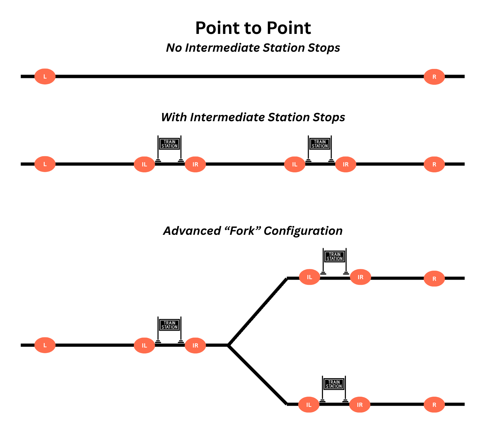
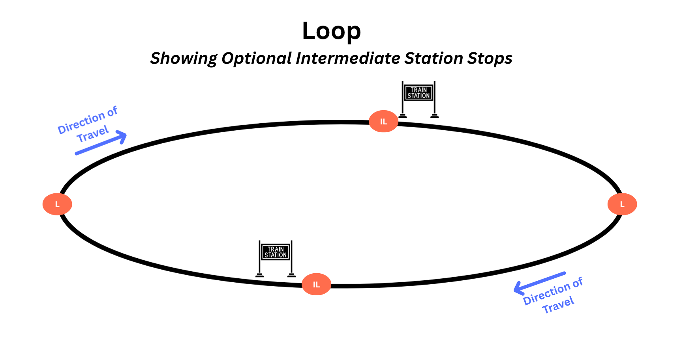
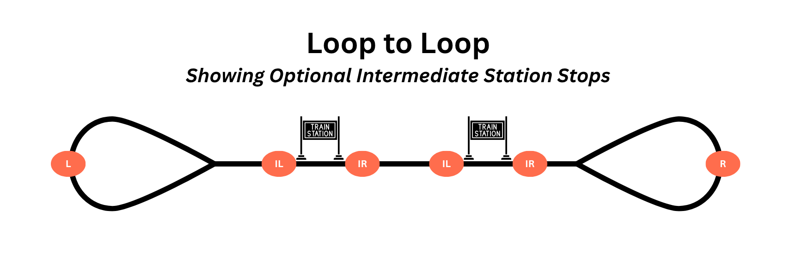
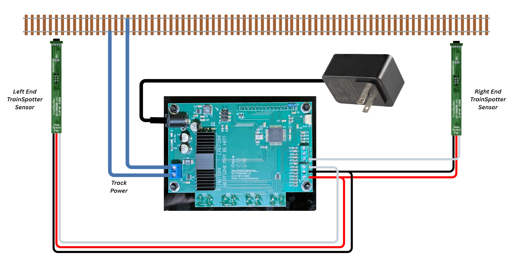
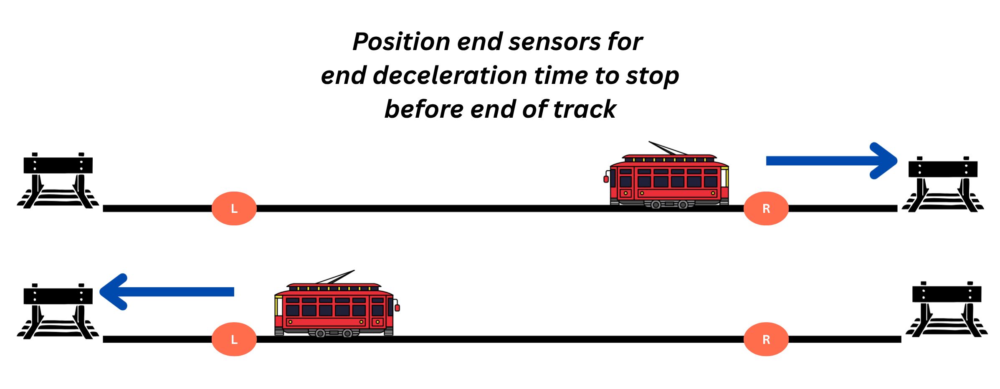
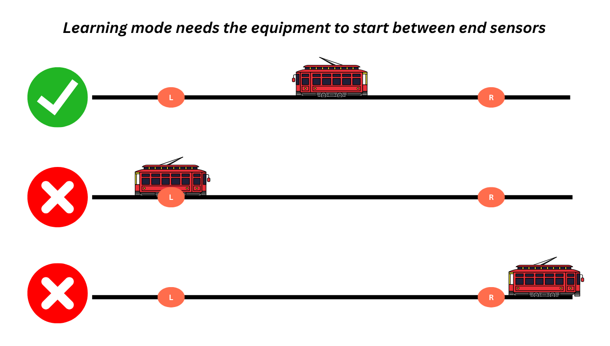
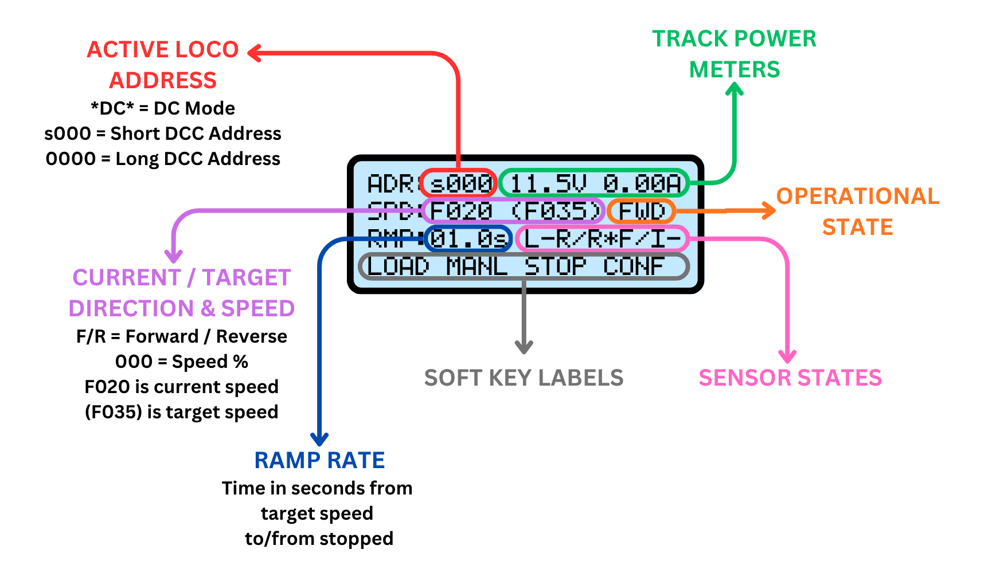
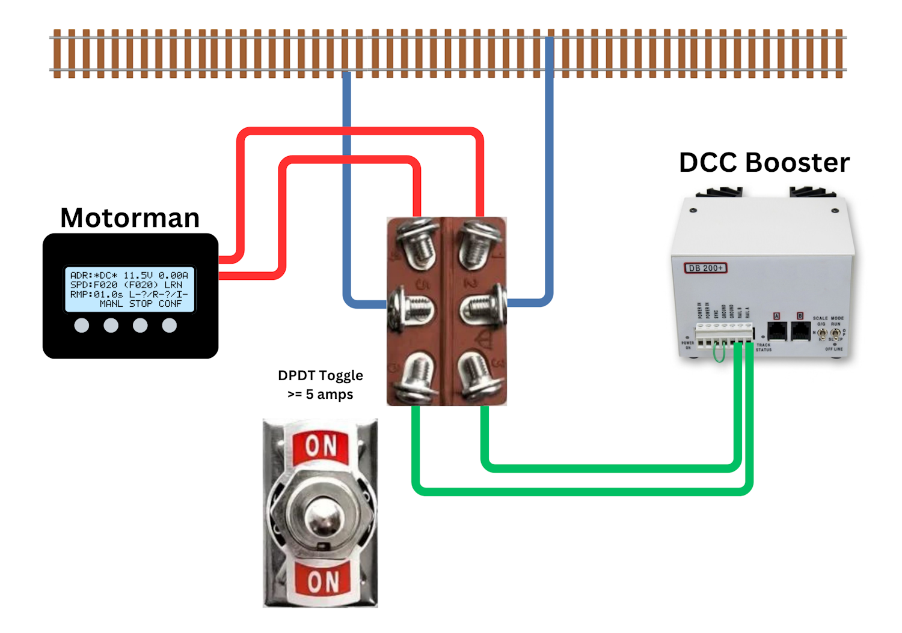
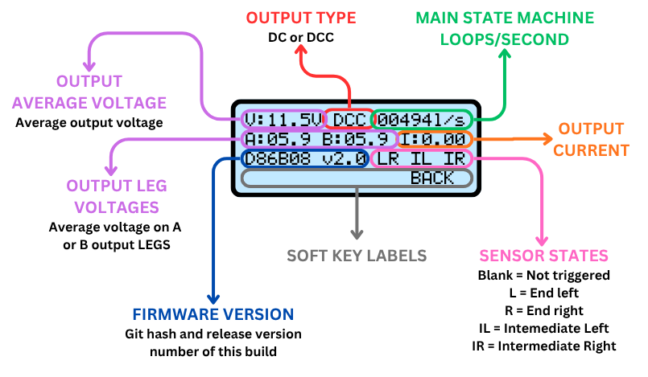

# Motorman {align=right style="height: 75px; margin-top:0px; margin-bottom: 0px"} User Manual

## Overview

The Iowa Scaled Engineering [Motorman](https://www.iascaled.com/store/CKT-PINGPONG) is an automatic train shuttle controller for both DC and DCC locomotives. Using TrainSpotter infrared sensors at each end, the Motorman will continuously drive the train back and forth, automatically stopping and reversing at the end of track as well as pausing at intermediate station stops. With control of the speed, locomotive address, delay time, and DCC accessory decoders, many different scenarios for automatic operation are supported.

The controller is designed to operate HO, N, and Z scale equipment.  Larger scales may work as well, as long as the user is careful not to exceed the 2 amp current output and is mindful that the under-track sensors may not have the range to sense the bottom of larger scale equipment.  For larger scales, the side / right angle sensors are recommended, mounted at roughly coupler height.

### Features

* Stores settings for up to 15 DCC locomotives
* Operates one DC or DCC locomotive or consist at a time on a single track
* Adjustable acceleration and deceleration rates
* Operates any long or short DCC address, including consists
* Supports intermediate stops (with additional sensors)
* Operates up to 6 accessory decoders based on selectable trigger events
* Fully integrated unit with simple, intuitive interface
* Built-in track short circuit protection
* 2 amp integrated output booster
* Optional track power switch for use with existing DC / DCC system

### Typical Applications

* Train show demo layouts
* Museum displays
* Home layout automation

### Kit Contents

* Control unit with LCD and buttons
* 12 volt, 3 amp wall power supply
* 2x TrainSpotter infrared detectors

---
## Supported Track Configurations

The original Motorman was only designed to operate a point to point track configuration.  Version 2 firmware adds Loop and Loop to Loop configurations as well.  Note that it can still only operate a single train on any of these configurations.

Sensor locations are shown as orange ovals, with **L** indicating sensors connected to the left end input, **R** indicating sensors connected to the right end input, and **IL** and **IR** indicating sensors connected to the intermediate left and intermediate right inputs respectively.

Multiple sensors can be connected to any given input.  This is particularly useful for things like intermediate stops, where you may have multiple along the route.

### Point to Point

This is the original configuration that the Motorman was intended to handle.  The Point to Point is available in all versions of the Motorman firmware.

Using DCC accessory decoders, it's possible to add switches in the middle of the line and multiple left or right ends.  It's just a modification on the same Point to Point use case.

### Loop

The "Loop" is just that - a circle of track, where the train always goes forward.  It only uses the Left and Intermediate Left sensors.  The equipment will always travel forward, stopping for the end delays when "left" sensors are triggered, and stopping for intermediate delays when "intermediate left" sensors are triggered.  Any sensor connected to "right" or "intermediate right" will have no effect in this mode.

### Loop to Loop

"Loop to Loop" is a combination of the two - a reversing loop on each end connected by a single track between.  The equipment always goes forward, but will obey the correct left or right intermediate sensors depending on direction of travel.  Plus, you can use actions based on the left and right end sensors to direct accessory decoder to line the reversing loop turnouts.

---

## Quick Start Guide

!!! warning "Please Note"
    All wiring should be done with the power off.  This significantly reduces the chances of accidentally slipping and causing a short circuit that damages the board or the detectors.

Here's a list of our recommended steps to get up and running.  We recommend just getting something running in the most basic mode first, and then adding more advanced features.  That allows you to figure out where things went wrong, rather than setting it all up and being utterly bewildered when all the complexity doesn't work the first shot.  Once you've got basic operations working reliably and are somewhat familiar with the unit, then you can start adding more advanced things, such as [accessory decoder control](#accessory-configuration) or [intermediate stop sensors].  

Wiring Overview Diagram  *(Click to enlarge)*

### 1 - Connect to the Track

The Motorman must be the only power source connected to the track when it's operating, and must be disconnected if any other device is powering the track.  Failure to observe this rule will damage the Motorman, your throttle/booster, or both.  If you want to switch between the Motorman and your regular booster/throttle, see [Switching Track Power](#switching-track-power) in Frequently Asked Questions.

Connect the track power bus to the blue 2-position terminal block marked "TRACK" or "J2".  

For DCC use, the polarity does not matter. If using DC mode, then the physical direction corresponding to forward and reverse will depend on the polarity of the feeder wires connected to the terminal block. If you end up with the direction opposite what you desire, then simply swap the two track wires in the terminal block.

### 2 - Position and Connect End Sensors

The basic kit includes two TrainSpotter optical sensors - one for each end of a basic point-to-point or loop-to-loop run.   We strongly recommend getting the end sensors operational first, and then adding any intermediate sensors.

Looking at your track, designate one direction left and one direction right.  End sensors should be positioned far enough from the end of track that equipment has time to decelerate to a stop before running out of rail.  The end deceleration rate is [configurable](#) to as little as a tenth of a second from when the sensor is tripped, but the result will be a jarring stop and won't appear very prototypical.  If it's happening in a hidden space, however, this may be fine.

As a tip, we recommend temporarily positioning them on the layout using small boxes or other supports to figure out the exact placement before drilling any holes and committing to a location.  Just make sure they don't come in contact with rails or anything else energized, or damage will result.

Once you've figured out roughly where you want them, connect them to the Motorman control board.  Red wires to into the **+12V** terminal.  Black wires go into the **GND** terminal.   The white wire from the left sensor goes into the **LEFT** terminal, and correspondingly, the white wire from the right sensor goes into the **RIGHT** terminal.

If you need longer wires to reach the ends of your track, just extend the wires using any small wire you have handy.  There's no significant length limit on how far the sensors can be from the control unit.

### 3 - Power the Motorman

Plug the barrel jack from the included power supply into the Motorman control unit, then plug the power supply into the wall.  The Motorman should power up, lighting the screen and diagnostic LEDs on the back of the board.

### 4 - Test Your Sensors

Let's make sure that your sensors are connected and working properly.  Take a piece of unpowered rolling stock (a boxcar will work fine, or even your hand) and place it in front of the left sensor.  You should see the red light on the sensor come on when something is placed in front of it and go off when the object is removed.  Now look at the main screen of the Motorman.  As asterisk should appear next to the L on the main screen when the left sensor is triggered, and go away when the sensor is not triggered.

If that works, repeat with the right sensor. 

!!! warning If either sensor test fails, stop and figure out what's not right.  Nothing will work unless the head unit is reliably receiving signals from the sensors. 

### 5 - Basic Configuration

To get up and running, we need to do some basic configuration.

The main Motorman unit has four "soft keys" below the display.  The bottom line of the display has a label above each, giving you its current function.  

**DC or DCC** - The Motorman comes by default in DCC mode, since that's the most common.  If you need to change to DC mode, you'll need to change it.  Go into the Configuration menu and change [DC or DCC mode](#dcdcc-output) to output DC instead.

**Travel Mode** - If you are running firmware 2.0 or later, set up your basic [Travel Mode](#travel-mode) to match your track configuration.  If you're on firmware before 2.0, only point to point was supported.

**Locomotive Config** - We'll need to configure a locomotive.  If you're operating a DCC locomotive, there's some chance it will work.  The Motorman by default sends speed commands to address 0, which according to the specification should be received and acted on by all locomotive decoders.  The reality is most manufacturers didn't implement it that way.  

To do the configuration, see the [Locomotive Config](#locomotive-configuration) menu.  A few tips:

If you're running DC, you'll want to configure the DC slot - 00.  We recommend setting would set the MAX speed to something greater than 20 to start, as this may not be enough to even break the static friction of some older motors.  I would recommend starting at 50-60% and you can always slow it down once you get it working.

If you're running DCC equipment, just use slot 01 for now and configure the bare minimum you need to get the equipment moving.  The only function I would configure initially is the "engine run" function for sound decoders that need it to make the unit move.  Put it in one of the always on function slots.

Once you're done configuring one of the DCC slots, load it into the active configuration.

### 6 - Try It Out!

Now, if you're ready to go, reset the Motorman into learning mode.  Hit "MANL" for manual operation, and then RINIT to get the Motorman back into its startup state.  Place your equipment somewhere in the middle between the two end sensors and see if it runs correctly.  If it does, great!

If it doesn't, then watch the sensor indicator asterisks on the main screen and the [operational state](#operational-state).  Usually you'll notice something that seems off, and that will point you at the issue.

### 7 - Adding Intermediate Sensors

Once you've got the basic installation working between the ends, now's the time to add any intermediate stop sensors.  Intermediate sensors are used to pause trains at station stops between the two ends.  Think of a trolley - it has an origin station and a destination station, but will pause at many stations along the route between the two end points.  That's what intermediate sensors do.

There are both left and right intermediate sensors so that they can be positioned some distance away from the actual station stop, allowing the equipment to decelerate to the same spot from both directions.   The left sensor should be to the left of the station, allowing space for right-bound equipment to come to a stop right in front of the station based on the configured deceleration rate in the [locomotive configuration](#locomotive-configuration).  Likewise, the right sensors should be to the right of the station, and allow left-bound equipment the same time/distance to stop.

The red and black wires from intermediate sensors go to the +12V and GND terminals, same as all other sensors.  The white wires from left intermeidate sensors should go to the I-L terminal, and intermediate right sensors should connect their white wire to the I-R terminal.  

(Note:  If you don't need deceleration distance to stop at a specific point, you can use a single sensor for the intermediate stop and wire the white wire into both the I-L and I-R terminals and it will serve as both.)

You can add as many intermediate pairs as you want.  Any Iowa Scaled Engineering TrainSpotter (except the TrainSpotter-M motion sensor) will work.  These additional sensors will come with a shorter wiring pigtail that has four wires.  The blue wire is not used in this application and should either be clipped or taped off so that it doesn't accidentally come in contact with anything.

---

## Operations

### Learning Mode

!!! info "Equipment Direction vs. Track Direction"
    An important concept to understand is the difference between track direction and equipment direction. Think of the problem this way – forward is relative to the locomotive, not to which direction it is headed on the track. The locomotive can go forward to the left, or it can go forward to the right, depending on which way it’s pointed. For the sensors installed along the track, their direction is always the same, because their relation to the track doesn’t change. One will be to the left, one will be to the right. 
    
    In this manual, the two ends of the track will be denoted as “left” and “right”, whereas the two directions of equipment travel will be denoted as “forward” and “reverse”.

When the Motorman starts up or goes through reinitialization, normally it will start in "Learning Mode."   It expects the locomotive to be located along the center section of the track, somewhere between the two end sensors.  It will then command the locomotive to drive forward until one or the other end sensor is triggered.  This is how it learns whether left or right is forward.

You can tell the Motorman is in learning mode by checking the [Operational State](#operational-state) on the [main screen](#the-main-screen).  If it's currently learning, it will show LRN as the operational state and it will show ? by the two end sensors instead of F or R.

Once the Motorman has learned which sensor (left or right) corresponds with forward movement, it will then start normal operation.

For operations where the relationship between forward and reverse will never change, you can use the [Sensor Learning](#sensor-learning) configuration setting to define which way is forward and reverse.  Normally it is better to just let it learn, but with certain applications it's better to configure it from the start.  

If you need the Motorman to relearn its directions, there are two ways to do this.  The first is to use the [Stop Relearns Direction](#stop-relearns-dir) configuration option.  This will put the Motorman back in learning mode whenever the stop key is pressed on the main screen.  It will not, however, set all of the accessory decoders back to their original states.  It will just relearn the end sensors.

The second option is to use the [Manual Operation](#manual-operation) screen.  When you exit it using the **RINIT** key, the Motorman will reset all accessory decoders to their original states and relearns direction as if it had just powered up. 

If the Motorman doesn't go into learning mode on startup, check that the sensors are all reading as clear on the head unit.  If that's not the problem, check that [Sensor Learning](#sensor-learning) isn't disabled and that [Resume on Power On](#resume-on-power-on) is also disabled.  Either one of these will set the left-right/forward-reverse relationship without going through learning.

### Normal Operation

#### The Main Screen

Most of the time, the Motorman will be sitting on the main screen.  It's designed to communicate a wealth of state information at a quick glance.

From the main screen, you can use **LOAD** to load a new active locomotive configuration if you're in DCC mode.  (In DC mode, it always uses [locomotive configuration](#locomotive-configuration) slot 00, so there is no load function key.) 

**MANL** allows you to manually operate the current locomotive.  *Note:  When you exit manual operation, the Motorman will reset to its "just powered up" state, since it has no idea where you moved the equipment since it was last in control.*

**STOP** pauses the current operation and will bring the equipment to a halt.  It will also change the key to **RUN!**, which will resume operations from that point when it's next pressed.  This is handy if a minor derailment or need to quickly fix something without restarting the whole operation.

**CONF** allows you to enter the [Configuration](#configuration) menu.

Here's a summary of the basic main screen items:

* **ACTIVE LOCO ADDRESS** - Shown in the upper left in red, this indicates the locomotive address that the Motorman is currently trying to control.  If it's in DC mode, it will simply show ****DC****.  If it's in DCC mode, it will show a four digit address for long addresses, or an s followed by three digits for short addresses from 1-127.
* **TRACK POWER METERS** - This section, shown in green, shows the current track voltage and current draw.  Depending on the hardware version, the current draw may be replaced with "FAULT" in the event of a track short or overload condition.
* **OPERATIONAL STATE** - Show in orange, the [Operational State](#operational-state) gives you an idea what state the Motorman is currently in.  This can be very handy for debugging why transitions aren't happening as expected.
* **SENSOR STATES** - This shows the current state of the sensor inputs and how they're mapped to forward and reverse.  The first three characters describe the left sensor.  For example, it might read L-? - meaning it's left sensor, the dash means it's not triggered, and the question mark means the Motorman hasn't learned if it's forward or reverse yet.  Likewise, it might read L*R, with the asterisk meaning that the sensor is currently triggered, and the Motorman thinks that left is the reverse direction for the current equipment.   The three characters representing the right sensor work similarly.  The next section with the I shows the intermediate sensors.  The character after the I shows which intermediate sensors are triggered.  IL would mean just intermediate left, IR means just intermediate right, and IA means both intermediate left and right are triggered.
* **SOFT KEYS** - The bottom line shows the current function of the four keys below the screen.  
* **RAMP RATE** - This is the acceleration/deceleration rate of the current locomotive configuration.  It's specified in the number of seconds from a stop to reaching full commanded speed, or from full speed to coming to a stop.  Note that this is just commanded speed from the Motorman.  If you are running DCC, any momentum programmed into the decoder is on top of this.
* **CURRENT/TARGET SPEED & DIRECTION** - This shows which direction the Motorman is currently commanding the equipment to go and how fast.  The value immediately following SPD: is the current commanded direction and speed (as a percentage), and the value in parenthesis is the target running speed and direction once any ramping up or down is done.

#### Operational State

The heart of the Motorman is a concept called a "state machine" - essentially a list of rules expressed as "Do this until X happens, then go on the next rule."  For example, a traffic light will display green until a timer expires.  We'll call that the green state.  When the timer in the green state expires, the next rule is start a new timer and display yellow.  The yellow state has an exit condition of the yellow timer expiring.  When that timer expires, it displays red and starts another timer.  When that timer expires, it goes back to the green state.

The Motorman is very similar.  It will drive forward until it reaches the end sensor in the forward direction.  Once it gets there, it decelerates until it stops.  Then it waits, reverses, and accelerates in the opposite direction.  These are all defined as "states" and you can see what it's currently doing and expecting based on the state displayed on the main screen.

* **LRN – Learning**  The Motorman is learning which track direction corresponds with forward. Once an end sensor is reached, that track direction (left or right) will be deemed “forward” until such time that the locomotive is changed, the STOP key is pressed (configurable), a reinitialization is triggered from [Manual Operation](#manual-operation), or the power is cycled. This association between left/right and forward/reverse will be indicated in the “Sensor Inputs” section of the main screen.

* **FWD – Forward Travel** The locomotive is driven forward at the speed set in the locomotive profile until either the end stop sensor is reached, or an intermediate sensor opposite the forward end is reached. If the end sensor is tripped, the state will go to FDC. If an intermediate sensor is tripped, the state will go to FID.

* **REV – Reverse Travel** The locomotive is driven in reverse at the speed set in the locomotive profile until either the end stop sensor is reached, or an intermediate sensor opposite the reverse end is reached. If the end stop sensor is tripped, the state will go to RDC. If the intermediate sensor is tripped, the state will go to RID.

* **FDC – Forward Deceleration** The forward direction end stop sensor has been tripped and the speed is decreasing to zero based on the locomotive’s ramp rate. Once the current speed reaches zero, the state will transition to FTR. 

* **FTR – Forward to Reverse Delay** The locomotive has stopped its forward travel and is waiting the configured Endpoint Delay to reverse direction. Once the delay has expired, the state will transition to REV 

* **FTF – Forward to Forward Delay**  The locomotive has stopped its forward travel and is waiting the configured Endpoint Delay. Once the delay has expired, the state will transition to FWD and the locomotive will continue forward.  *Only applicable in Loop or Loop to Loop [travel modes](#travel-mode).*

* **RDC – Reverse Deceleration** The reverse direction end stop sensor has been tripped and the speed is decreasing to zero, as set by the locomotive’s ramp rate. Once the current speed reaches zero, the state will transition to RTF.

* **RTF – Reverse to Forward Delay** The locomotive has stopped its reverse travel and is waiting the configured Endpoint Delay to reverse direction. Once the delay has expired, the state will transition to FWD

* **FID – Forward Intermediate Deceleration** A forward intermediate sensor has been tripped and the equipment is decelerating to zero speed. Once the speed reaches zero, the state will transition to FIW.

* **RID – Reverse Intermediate Deceleration** A reverse intermediate sensor has been tripped and the equipment is decelerating to zero speed. Once the speed reaches zero, the state will transition to RIW.

* **FIW – Forward Intermediate Wait** The locomotive has stopped in the forward direction at an intermediate sensor, and will wait for the configured delay. Once the delay expires, state will transition to FIA.

* **RIW - Reverse Intermediate Wait** The locomotive has stopped in the reverse direction at an intermediate sensor, and will wait for the configured delay. Once the delay expires, the state will transition to RIA.

* **FIA – Forward Intermediate Acceleration** The locomotive is accelerating forward out of an intermediate stop. As soon as the tripped intermediate sensor clears, the state will transition to FWD.

* **RIA – Reverse Intermediate Acceleration** The locomotive is accelerating in reverse out of an intermediate stop. As soon as the tripped intermediate sensor clears, the state will transition to REV.

----

### Manual Operation

From the main screen, the MANL key will allow you to operate the current locomotive manually.  It can also be used as a quick shortcut to rebooting into [learning mode](#learning-mode) in version 2 and higher firmware.

!!! note "Change From v1 Firmware"
    In version 1, the manual operation was still affected by sensor triggers and acceleration/deceleration rates, and was confusing to users.  In version 2 firmware, manual operation is immediate and overrides automatic operation completely.

**SPD+** and **SPD-** will increase and decrease the current locomotive speed by 1%.  **F<>R** will immediately set the speed to 0 and reverse the direction.  

**RINIT** will exit manual operation and restart the Motorman.  If [learning mode](#learning-mode) on startup is not disabled by the [Sensor Learning](#sensor-learning) or [Resume on Power On](#resume-on-power-on), this is a quick and easy way to kick the Motorman back to learning the relationship between the equipment and the sensors.

---

## Configuration

The Motorman is configured using the **CONF** soft key off the main screen.  This will put you into a menu where you can select a number of configurable items.  The **UP** and **DOWN** soft keys will move the cursor on the left side up and down between configuration items.  Press **SLCT** to choose which item to configure, or **BACK** to return to the main screen.

Configuration Items:

* [Locomotive Config](#locomotive-configuration)
* [Accessory Config](#accessory-configuration)
* [DC/DCC Output](#dcdcc-output)
* [Endpoint Delay](#endpoint-delay)
* [Midpoint Delay](#midpoint-delay)
* [Midpoints Enable](#midpoint-enable)
* [Travel Mode](#travel-mode) - *Only available in firmware v2.0 and greater*

### Locomotive Configuration

The **Locomotive Configuration** screen allows you to configure and store up to 15 locomotive configurations – one for DC operation and 14 for DCC operation.

Slot 00 is always DC, and is the only configuration for DC.  Slots 01 to 14 are for DCC operation.   

Slot 00 is automatically used when [DC operation](#dcdcc-output) is selected.  For DCC operation, the **LOAD** button on the main screen is used to select which configuration slot is active.

Each line shows the configuration slot number, DCC address (or ****DC**** for slot 0), maximum speed (0 to 100%) and ramp rate (0.1 to 25.5 seconds). Use the **UP/DOWN** keys to select the configuration to change, and press the **SLCT** key to reconfigure that go into the Configure Locomotive screen #1. The **BACK** key will take you back to the main configuration screen.

Here's a flowchart of how the screens fit together:

#### Address & Speed

The first screen sets the locomotive address, maximum speed, and acceleration/deceleration rate.  It shows the configuration slot number in the upper left corner as a reminder of which slot you're changing.

The keys operate similarly for all of the configuration screens.  The third line will have a **^** (carat) showing which digit or field is currently being changed.  Use the **++** key to increment the current field, and the **>>** key to change which digit or field is being adjusted (as shown by the ^ under the value).  

**ADDR** is the address of the locomotive or consist being controlled by this slot.  If you're configuring the DC slot (00), this will just show **-DC-** since there's no address to specify. 

To specify a short DCC address, set the first slot to **s** followed by a number between 0-127.  For long DCC addresses, change the first digit to an appropriate number, including 0 for addresses less than four digits.

**MAX** is the maximum speed, expressed as a percentage from 1-100%.  

!!! info "DC Maximum Speed" 
    Note that for DC, the **MAX** percentage directly corresponds to track voltage.  Depending on the motor and any electronics in the locomotive, you may have to go up to 30-50% just to get the thing to move due to static friction, voltage drops, etc.

**RAMP** is the number of seconds that the Motorman will take to accelerate the locomotive from a stop, or decelerate into a stop after the sensor is tripped.

!!! info "DCC Decoder Momentum" 
    The Motorman assumes that it is in direct control of the equipment, and **RAMP** will be how fast it accelerates or decelerates a locomotive.  Any momentum set up in the decoder will be on top of this.  In general, it's preferable to either use decoder momentum or Motorman momentum rather than trying to mix them.

If you're configuring one of the 14 DCC slots (01-14), the **NEXT** key will move you on to the first function configuration screen.  If you're configuring the DC slot (00), then you'll have a **SAVE** button instead that will save the configuration.  To cancel out without saving any changes, press the **CNCL** key.

#### Function Screens

These two (version 1 firmware) or three (version 2 firmware) screens allows you to set DCC decoder function behavior. 

For all of them, **F--** indicates that no function is selected. If the field is set to **F00** to **F28**, that function will be active when this locomotive slot is active.

The keys operate similarly for all of the configuration screens.  The third line will have a **^** (carat) showing which field is currently being changed.  Use the **++** key to increment the current field, and the **>>** key to change which field is being adjusted.  

!!! info "F29 to F68 Not Supported"
    The Europeans have added more functions to the DCC specification through RCN-212.  The Motorman only currently supports F00-F28.

##### Always On Functions (v2+)

These functions will always be active for this locomotive, no matter the direction of travel.  This is useful for things like the "engine run" on most sound decoders that need to be active for sounds to work or the locomotive to move, or for functions that turn on lights that are always desired to be on, such as rotary beacons or even F0 for directional headlights.

For version 2, the whole first screen is dedicated to four "always on" functions.  Each of these functions is labeled "ALL" and it looks like this:

##### Always On Functions (v1)

!!! info "Version 1 Firmware Only" 
    The original Motorman firmware only supported a single "always on" function.  

Version 1 of the Motorman firmware only supported a single "always on" function.  It's on the first function screen - same as the directional functions - and located on the far left near the slot number.  It's circled in red below.

##### Direction Functions

The Motorman has provisions to turn on up to two functions when the locomotive is running forward (labeled **FWD**), and two functions when the locomotive is running in reverse (labeled **REV**).  These are useful for things like ditch lights, Mars or Gyralights, or non-directional headlight functions.  

For version 1 firmware, these share the same screen as the single "always on" function.

##### Accel/Brake Functions

The Motorman also has a single function that can be turned on during acceleration, and one that can be turned on during braking / stopping.  The **ACC** function will be enabled when a locomotive is accelerating out of a stop, and turned off once the locomotive reaches full speed.  The **BRK** function will be turned on when a locomotive trips a sensor and starts decelerating, and remain on until the locomotive is ready to accelerate again.

---

### Accessory Configuration

While operating in DCC mode, the Motorman to drive up to six accessory decoders based on sensor triggers.  These are configured from the the **Accessory Config** menu.

The main screen shows each of six slots and a summary of what's in each one.  First is the two digit slot number, then the four digit accessory extended address (0001-2044), then the trigger type, the current state (**S**=set, **C**=cleared), and the initialization state in braces (**[S]**=set, **[C]**=cleared).

Using the **UP** and **DOWN** keys, you can select which slot you want to change using the **>** on the left and then pressing **SLCT**.  At that point, you will go into the accessory configuration screen

!!! warning "Accessory Power Draw"
    Remember that any power used by accessory decoders and their loads comes out of the Motorman's 2 amp output power limit.  Thus, it's recommended to avoid things like twin coil switch machines that draw significant power, as the instantaneous rush of current may trigger the Motorman's overcurrent protection.  Tortoises or similar low-power stall motor machines attached to accessory decoders such as the NCE SwitchIt are recommended.

#### Configure Accessory Slot

Each accessory slot will give a screen allowing you to configure the details of that slot.  On the left, under **ACC** will be the slot number as a reminder.  Then the four-digit extended accessory address under **ADDR**, which runs from 0001-2044.  **INIT** will be the state sent to the decoder when the Motorman initially powers up or goes through a reinitialization.  Finally, **TRIGR** defines what causes the accessory state to change between clear and set.

##### Trigger Types
* **DISBL - Disable** - Do not use this accessory configuration at all. No initialization will be sent, and it will never change in response to sensor input.  Unused accessory decoders should be left as DISBL.
* **INIT – Initialize Only** – Set the accessory decoder to its configured initial state only when the unit powers up. Never changes based on sensors.
* **LSTOG - Left Stop Toggle** - When the left end stop is reached, toggle the state of this accessory address (set will go to clear, clear will go to set). The right end stop has no effect.
* **RSTOG – Right Stop Toggle** – When the right end stop is reached, toggle the state of this accessory address (set will go to clear, clear will go to set). The left end stop has no effect.
* **XSTOG – Both Stop Toggle** – When either end stop is reached, toggle the state of this accessory address (set will go to clear, clear will go to set).
* **LC_RS – Left Clear, Right Set** – Clear the accessory when the left end stop sensor is triggered, set the accessory when the right end stop sensor is triggered.
* **LS_RC – Left Set, Right Clear** – Set the accessory when the left end stop sensor is triggered, clear the accessory when the right end stop sensor is triggered.
* **LE_ST – Left End Station Trigger** – Set the accessory when a locomotive reaches the left end stop sensor and clear it when it departs,
* **RE_ST – Right End Station Trigger** – Set the accessory when a locomotive reaches the right end stop sensor and clear it when it departs,
* **XE_ST – Both End Station Trigger** – Set the accessory when a locomotive reaches either end stop sensor and clear it when it departs,
* **LI_ST – Left Intermediate Station Trigger** – Set the accessory when a right-bound locomotive reaches the left intermediate sensor and clear it when it departs.
* **LI_ST – Left Intermediate Station Trigger** – Set the accessory when a left-bound locomotive reaches the right intermediate sensor and clear it when it departs.
* **XI_ST – Left Intermediate Station Trigger** – Set the accessory when a locomotive reaches the intermediate sensor approaching an intermediate stop in either direction, and clear it when it departs.

---

### DC/DCC Output

The Motorman has the ability to act as a small DCC command station or a regular DC throttle.  This menu controls what sort of signal is sent out to the track.  The **DCC** key selects DCC mode while the **DC** key selects DC mode. The **SAVE** key will save and activate the selected setting. To cancel out without saving any changes, press the **CNCL** key.

---

### Endpoint Delay

The endpoint delay is how long the locomotive will wait at each end of the run.  This is the time between when the locomotive reaches a stop and when it begins to accelerate again.  This is used for the FTR, RTF, and FTF [operational states](#operational-state).

The value is configurable between 0 and 65535 seconds (a bit over 18 hours), and defaults to 2 seconds.  Use the **++** key to increment the current digit, and the **>>** key to change which digit is being adjusted (as shown by the ^ under the value).  The **SAVE** key will save and activate the selected setting. To cancel out without saving any changes, press the **CNCL** key.

---

### Midpoint Delay

The midpoint delay is how long the locomotive will wait at any intermediate station stop.  This is the time between when the locomotive reaches a stop and when it begins to accelerate again.  This is used for the FIW and RIW [operational states](#operational-state).

The value is configurable between 0 and 65535 seconds (a bit over 18 hours), and defaults to 2 seconds.  Use the **++** key to increment the current digit, and the **>>** key to change which digit is being adjusted (as shown by the ^ under the value).  The **SAVE** key will save and activate the selected setting. To cancel out without saving any changes, press the **CNCL** key.

Note that the Midpoint Delay setting will have no effect unless the midpoint sensors are activated in the [Midpoint Enable](#midpoint-enable) configuration option.

---

### Midpoint Enable

By default, the midpoint stops are not enabled and those intermediate sensor inputs will be ignored. This prevents any glitches on the unconnected intermediate sensor lines from disrupting normal operation.  If you do want to use them, you need to enable them here.

The asterisk will show the currently selected value.  Use **ENBL** to enable the midpoint stops and sensors.  Use **DSBL** to disable them.  The **SAVE** key will save and activate the selected setting. To cancel out without saving any changes, press the **CNCL** key.

---

### Travel Mode

The "travel mode" is describes how the track is configured, and how you want the equipment to operate over that track.

The original Motorman firmware only supported a single travel mode - Point to Point.  This was a track with two ends, and the equipment would "ping pong" between the two ends.  Version 2.0 of the firmware added two new modes - Loop and Loop to Loop (Lp2Lp). 

#### Point-to-Point

In this mode, equipment will travel forward until it reaches an end sensor.  At that point it "learns" whether left or right is forward.  It will wait a programmed amount of time, and then reverse until it reaches the opposite sensor.

Along the way, it will stop upon reaching intermediate sensors in its direction of travel.  If traveling left, it will stop for intermediate right sensors.  If traveling right, it will stop for intermediate left sensors.

#### Loop

In this mode, equipment always operates forward around a loop.  Only the left and intermediate right sensors have any effect.  

Upon reaching any left sensor, the equipment will pause based on the end stop delays, and any accessory actions tied to the left sensors will trigger.

Upon reaching any intermediate right sensor, the equipment will base based on the intermediate delays, and any accessory actions tied to the intermediate right sensors will trigger.

#### Loop to Loop

In this mode, equipment always operates forward.  When it reaches an end sensor, it will "learn" if left or right is forward. 

Except for the equipment always traveling forward, this works identically to Point-to-Point mode.  

Accessory actions or other systems not connected to the Motorman can be used to set the turnouts on the ends of the loops.

---

### Sensor Learning

For [learning mode](#learning-mode), equipment must start between the two end sensors.  If the Motorman is trying to "learn" if forward is left or right, it will indicate by showing "LRN" as its operating state, and the ? will appear next to the left and right sensors.  If you want to skip learning and go immediately into operations, then using the this configuration option, you can define the relationship between forward movement and going left or going right.  

Select **Learn** if you want the Motorman to start up in learning mode.  

Select **Right** if you want to define that forward movement is always to the right.

Select **Left** if you want to define that forward movement is always to the left.

Select **SAVE** to save and exit, or **CNCL** to discard your change and back out to the [Configuration Menu](#configuration).

---

### Stop Relearns Dir

This screen allows you to configure whether the Motorman re-learns direction every time the **STOP** button is pressed from the [main screen](#the-main-screen).  It's sometimes useful for the Motorman to go back into [learning mode](#learning-mode) when you pause operations.  For example, if you're testing new locomotives or testing a fix on one, you may not be careful about which way you put it back on the track after making adjustments.  Or it's a handy way to get in and out of learning mode without resetting the state of the whole system through the [Manual Operation](#manual-operation) function.

Select **YES** to go into learning mode every time the **STOP** button is pressed on the main screen.  

Select **NO** if you just want the Motorman to resume from where it was when you hit **STOP** and then **RUN!** again.

Select **SAVE** to save and exit, or **CNCL** to discard your change and back out to the [Configuration Menu](#configuration).

---

### Resume On Power On

In this mode, the Motorman continuously saves its current state, such that in the event of losing power, it can pick up right from where it left off when power is reapplied.  This is useful for building closed museum dioramas or other systems where there's not going to be a human in place to always reposition equipment for system start-up.  

Select **YES** to have the Motorman pick up from where it was last when power went down.

Select **NO** to have the Motorman start up in a fresh, initialized state when the power is reapplied.

Select **SAVE** to save and exit, or **CNCL** to discard your change and back out to the [Configuration Menu](#configuration).

Note:  Resume On Power On bypasses [learning mode](#learning-mode) once the relationship between left/right and forward/reverse is learned, even on initial power up.  To re-enter learning mode, you can either turn on the [Stop Relearns Dir](#stop-relearns-dir) function and press the **STOP** button to get into learning mode, or you can disable Resume On Power On and restart.  Normally in the sort of situations, it's usually helpful to just disable [Sensor Learning](#sensor-learning) entirely and tell the system which direction corresponds with forward travel.

Note 2: Resume On Power On bypasses the introductory splash screen so that it doesn't miss any events.  It will drop you immediately into the [main screen](#the-main-screen) when power is reapplied.

Note 3: It is highly recommended to not use momentum or large keep-alives in locomotives being used with Resume On Power On.  If the locomotive moves after the Motorman loses power, it may coast over an unpowered sensor and the Motorman will not register the event since it's off.  Operation after that is undefined, and probably not good.

!!! warning "Non-Volatile Memory Wear"
    The "Resume on Power On" functionality is constantly saving the Motorman's state to the internal non-volatile memory, so that it knows what was last happening when the power went down.  This non-volatile memory has a finite number of writes before it will start exhibiting errors and fail.  The firmware does wear-leveling and spreads the wear out, but even then, may cause the device to wear out in about a decade of continuous operation, assuming a 30 second run between endpoints.  Just FYI.

---

### Pause on Start

Normally the Motorman immediately begins operations upon being powered up.  This configuration menu allows you to select **Running** if you want the Motorman to start up and immediately begin operating the last selected locomotive, or **Paused** if you want it to start up paused and wait for you to hit the **RUN!** key from the [main screen](#the-main-screen).

Select **SAVE** to save and exit, or **CNCL** to discard your change and back out to the [Configuration Menu](#configuration).

---

### Backlight Timeout

Normally, the screen backlight will stay on continuously.  If you want it to time out automatically after no buttons have been pressed for a period of time, that can be configured here.  The range is 10 - 250 seconds in 10 second intervals, or select NONE to keep the backlight on continuously.

*Note: If the backlight is off, the first button press wakes up the screen and does not do whatever that button would normally do.  This is a little disconcerting at first if you're not used to it.*

Select **SAVE** to save and exit, or **CNCL** to discard your change and back out to the [Configuration Menu](#configuration).

---

### Turn Off Backlight

This does exactly what it says - turns off the backlight immediately, regardless of how [Backlight Timeout](#backlight-timeout) is set.  

*Note: If the backlight is off, the first button press wakes up the screen and does not do whatever that button would normally do.  This is a little disconcerting at first if you're not used to it.*

---

### Diagnostics

Please see the [Diagnostic Screen](#diagnostic-screen) of the [Debugging](#debugging) section.

---

### Factory Reset

When all else fails, this is a way to return the Motorman to its factory default state.  

There's a lot of confirmation here so you don't accidentally do it.  The first screen requires you to press the **YES!** button five times, and will count down.  Then there's one final confirmation screen that moves the **YES!** button one to the right.  If you press that, it will wipe all configuration from the Motorman and reset it to the factory state.  Pressing **CNCL** at any point will back out to the [Configuration Menu](#configuration) and stop the reset process.

---

## Frequently Asked Questions

### Switching Track Power

The Motorman must be the only power source connected to the track while it's operating, and likewise needs to be disconnected if you want to operate it with your standard DCC booster or DC Throttle.  Failure to observe this rule will end with damage to one or both and possibly to any equipment sitting on the track at the time.

The safest way to switch between the two is by using a DPDT toggle switch rated at 5 amps or greater.  Wire it as shown below.

### Excess Inrush Current

The Motorman has an extremely fast short circuit detector, since it's intended for unattended operation and safety is a priority.  If there's too much capacitance on the track when it powers up, the Motorman may see this as short circuit due to the inrush current.

For DCC, often the answer is as simple as adding 6-10 feet of paired wire (such as lamp cord) between the Motorman and the track.  This often adds just enough inductance to solve the problem.  

For more extreme scenarios, adding a very low resistance, large wattage power resistor in series with one of the track power outputs may be needed.

### Additional Sensors

Additional sensors can be added for more end or intermediate stops using any of our standard TrainSpotter sensors, **except for the TrainSpotter-M**.  The motion-sensitive TrainSpotter-M sensors detect movement rather than position, and thus are not useful for the Motorman.

Multiple sensors can be connected to the same input (end or midpoint).  Just connect all the wires together of the same color and put them into the correct terminal block.

If you have more wires than can be comfortably connected to the terminal blocks on the board, an external terminal block or splice can be used to combine them into a single wire or two that connects to the Motorman head unit.

The 8 foot cables that come with the Motorman only have red, black, and white wires.  Additional generic TrainSpotter sensors will come with a short four-wire harness.  The blue wire is not used in this application.  Just clip it or tape it off so it doesn't accidentally come in contact with something.  Wires can be extended and spliced as needed - there is no ptractical limit.

### Debugging

If the Motorman isn't responding the way you think it should, almost always the first thing to check is the sensors.  

Step 1 - Verify that if you move equipment over them, the red light on the sensor turns on, and when it's removed the light turns off.  If it doesn't, try your hand.  If you can't get the red light to come on at all, either the sensor is not getting power (most likely - check red/black wires) or the sensor has gone bad (significantly less likely).  If your hand works and the equipment doesn't, there's probably too much space between the sensor and your equipment.

Step 2 - Verify that the Motorman sees the sensor input.  When the sensor is not triggered, verify that the red light is off and check the sensor state on either the [main screen](#the-main-screen) or on the [diagnostic screen](#diagnostic-leds).  It should be showing that sensor as not triggered.  Activate the sensor and verify that the red light comes on, and that the corresponding sensor indicator on the screen turns on.  If the red light on the sensor turns on but the indicator on the screen does not, then check the white wire connection.  If that seems good but the sensor indicator on the Motorman screen still doesn't turn on, use a short piece of wire to connect between the GND and sensor input terminals on the Motorman.  (Be very careful not to brush against any other connection.  You can easily kill the Motorman input or the output on the sensor.)  If it now turns on, then it's either a bad white wire or bad sensor.  If it doesn't turn on, the Motorman input is bad.

Step 3 - If the sensors are all turning on and off correctly on the Motorman screen, then the issue is likely either in configuration or you've found a bug.  Usually it's a configuration problem.  Use the [operational state](#operational-state) to watch how the Motorman responds to the sensor inputs, and this may point you at the issue.  If you think you've found a bug, figure out how to reproduce it reliably, document the steps and your configuration, and send it to support@iascaled.com for us to look at.

#### Diagnostic Screen

The diagnostic screen in the configuration menu can offer a few more hints as to what the Motorman is doing internally and help debug certain issues.

* **OUTPUT AVERAGE VOLTAGE** - The average voltage being delivered to the track.  This is the same as on the main screen.
* **OUTPUT LEG VOLTAGES** - The average voltage being generated on each side of the output bridge, relative to the negative input of the power supply.  For DCC, these should be roughly half the average voltage above, since DCC is a (mostly) symmetric square wave.  For DC, one or the other will be zero, whereas the other should mostly match the output voltage.
* **OUTPUT TYPE** - The currently configured output type - DC or DCC.
* **MAIN STATE MACHINE LOOPS/SECOND** - How quickly the main loop in the device is running and handling events.  Anything more than a few hundred times a second is more than fast enough, but can help spot slowdowns in the code caused by certain unusual conditions.
* **OUTPUT CURRENT** - How many amps are currently being drawn from the Motorman.  This is the same as on the main screen.
* **SENSOR STATES** - These are positional.  They either display a blank or a character.  L indicates that the left end sensor input is triggered.  R indicates the the right end sensor input is triggered.  IL indicates the intermediate left input is triggered, and IR indicates the intermediate right input is triggered.
* **FIRMWARE VERSION** - The Git hash and human-friendly firmware version this Motorman is running.

#### Diagnostic LEDs

On the back of the Motorman board, you will find several LEDs that help verify correct operation.

When power is applied to the board, the green LED labeled **D1** (also labeld **3.3V PWR**) should be glowing brightly.  If this is not on, then the board is not receiving power.

In DCC mode, both the blue and orange LEDs labeld **TRACK PWR** should be glowing.  

In DC mode, one or the other of the **TRACK PWR** LEDs should be glowing if the speed is above 0.  Because DC mode is voltage and polarity controlled, the blue LED lights in proportion to the voltage in one direction, and the orange LED lights in proportion to the voltage in the other direction.

---

## Firmware Release History

**Version 1.0** 
*Released 30 Oct 2020*

Initial production release firmware.

**Version 1.1** 
*Released 4 Jan 2021*

Fixes the following bugs:

* Watchdog timer occasionally would reset the Motorman partway through a factory reset, leading to a corrupted configuration memory.
* Couldn't set a short address after setting a long address in a locomotive configuration slot.
* Could select short addresses >127 (related to previous bug)
* Can't get to zero speed in manual operating mode.

**Version 1.2** 
*Released 14 Jan 2025*

Fixes the following bugs:

* Fix issues with accessory trigger modes LS-RC and LC-RS having false triggers when equipment passed the end sensor and came back through.

**Version 2.0**
*Released 15 Oct 2026*

Adds the following features:

* Added three extra "always on" DCC functions for each locomotive configuration
* End and midpoint delays can now be up to 65535 seconds, rather than the previous 255 seconds.
* Added Travel Mode menu to allow for Loop and Loop to Loop track configurations
* Added Sensor Learning menu to pre-configure the relationship between forward and reverse and left and right.  
* Added Resume on Power On option, which allows the Motorman to pick up exactly where it left off when the power is cycled, such as in a museum display that gets turned on and off every day.  
* Changes how [Manual Operation](#manual-operation) works.  Previously, Manual Operation would try to tweak and adjust the automatic Motorman operation.  This often led to confusion for users.  It is now fully manual, and allows you to manually operate equipment without the Motorman's automatic functions getting in the way.  

Fixes the following bugs:

* "Stop Relearns Direction" didn't actually save and was only effective until the power turned off.
* Reloads locomotive configuration when changing the DC loco configuration in DC mode.  Previously it only took effect on the next power cycle.
* Several configuration menu save keys had some anomalous code that could have prevented saving in rare cases.
* Pausing at ends and intermediates in reverse would enable the forward functions while stopped.  Now the reverse functions remain on even while stopped.

---

## Specifications

**Input Power:**  12 volts DC @ >2 amps, 2.1x5.5mm barrel jack, center positive  
**Output Power:** Up to 2 amps @ 12V, DC or DCC  
**Sensor Inputs:** Active low, pulled up to 3.3V.  ***Do not exceed 3.3V.***

---

## Open Source 

Iowa Scaled Engineering is committed to creating open designs that users are free to build, modify, adapt, improve, and share with others.

The design of the Motorman (CKT-PINGPONG) hardware is open source hardware, and is made available under the terms of the [Creative Commons Attribution-Share Alike v3.0 license](http://creativecommons.org/licenses/by-sa/3.0/).  Design files can be found in the [ckt-pingpong](https://github.com/IowaScaledEngineering/ckt-pingpong) project on GitHub.

The firmware for the Motorman (CKT-PINGPONG) is free software: you can redistribute it and/or modify it under the terms of the GNU General Public License as published by the Free Software Foundation, either [version 3 of the License](https://www.gnu.org/licenses/gpl.html), or any later version.  Firmware for the ckt-pingpong can be found in the [ckt-pingpong](https://github.com/IowaScaledEngineering/ckt-pingpong) project on GitHub.
